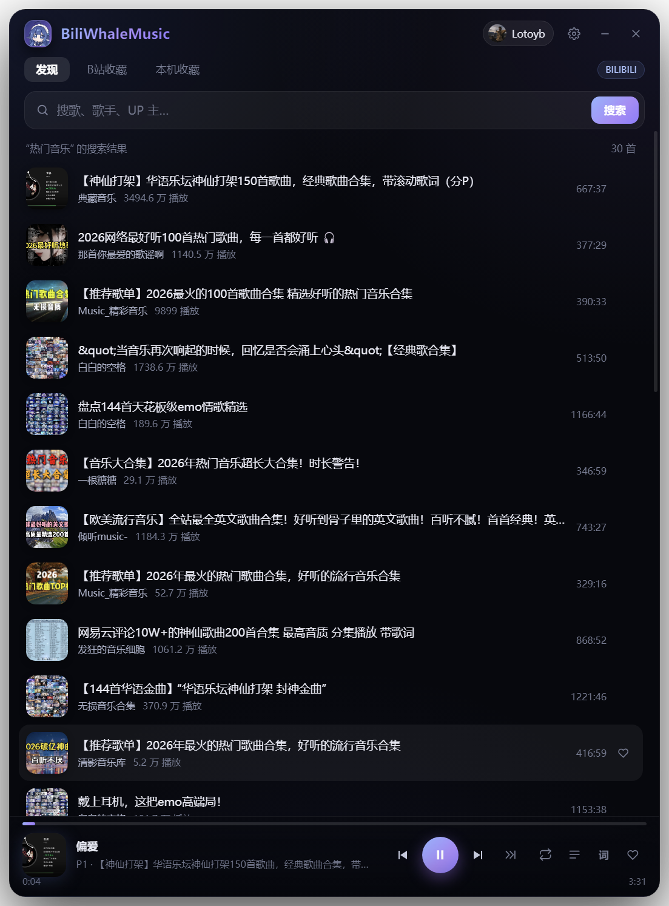
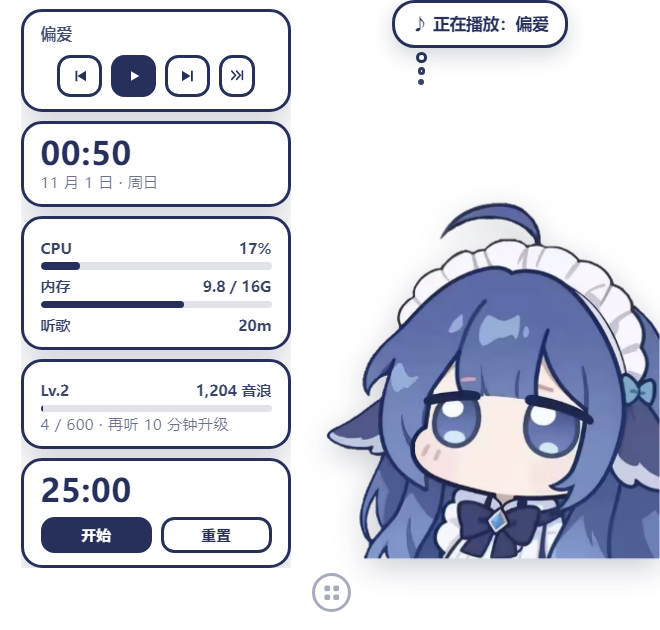
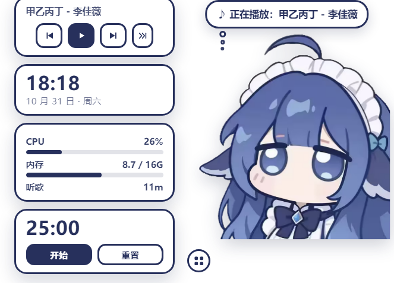

# BiliWhaleMusic · Little Whale × Bilibili Music Player


> English · [中文](README.md)

A runnable experiment that "merges several open-source projects into one":

| Source | What is borrowed |
| --- | --- |
| **Biu** (wood3n/biu, Electron + React) | Bilibili audio source: WBI signing, search, video detail, audio stream parsing, player interaction paradigm |
| **dsh-whale-widget** (MeteorNOX, DSH web plugin, MIT) | Pet mascot look and interaction: DeepSeek whale girl, white speech bubble with deep-blue outline, petting animation |
| **DesktopFriends** (Tosuke-sama/DesktopFriends, Tauri + Vue + Live2D) | "Desktop companion" product form: transparent always-on-top window, playback-state linkage, Live2D slot |
| **ANeko** (pass-with-high-score/ANeko, Android + Compose) | Desktop pet interaction habits: dragging, context menu, always-on-top widget window |

> The player and Bilibili integration are implemented independently; the pet
> mascot art and bubble style are recreated from **dsh-whale-widget** (MIT,
> see `assets/whale/LICENSE-dsh-whale-widget.txt`).







## What it can do

- **Little whale desktop pet**: transparent, frameless, always-on-top window,
  **fixed in the bottom-right corner, it does not wander on its own**;
  hold to drag it anywhere, the position is remembered and restored on next launch.
- **Click to open panel / double-click to pet the head**: a single click toggles the
  widget panel (its first card is playback control); double-click pets the whale —
  `rua.gif` + hearts + bubble feedback.
- **Pet widget panel**: hovering the mouse over the whale reveals a round
  button at its lower-left; clicking opens a small panel attached to the whale,
  with four cards from top to bottom:
  - **Playback control**: current track name + previous / play-pause / next / next playlist (only when collections exist);
  - **Clock**: time + date and weekday;
  - **System**: CPU and memory usage (real-time progress bars, turning red above 80%) + total listening time;
  - **Pomodoro**: 25-minute countdown, start/pause/reset, bubble reminder when finished.

  Panel open state is remembered and restored on next launch.
- **Listening time tracking**: accumulates while playing (paused time not counted),
  persisted every 10 seconds; continues across exit, refresh and restart.
  Stored in `biuwhale.json` as `listenTotal` / `listenToday` / `listenDate`;
  today's counter resets across days.
- **Same thinking bubble as the widget**: white background + deep-blue outline +
  three dots, automatically shows the track name when switching songs.
- **It sways while listening**: the whale gently rocks to the beat while playing,
  returns to floating when paused.
- **Bilibili login (global)**: account pill in the top-right corner, visible on
  every page — click it when not logged in to open the official Bilibili login page
  (QR code / password / SMS, freely resizable); after login it shows avatar and
  nickname; click to "Open Bilibili favorites / Log out".
- **Bilibili favorites**: switch between favorite folders in the "Bilibili favorites"
  tab and play favorite videos directly; account info is stored locally only.
- **Local favorites**: click the heart on the right of a track to favorite it
  locally, no login required.
- **Bilibili audio source**: keyword search → pick a track → play the audio track of
  the video directly (no need to open the web page).
- **Multi-P collections auto-expanded**: for multi-part videos like "100-track
  collections", each part is split into a queue entry, each parsed and displayed
  as "track name - artist".
- **Next playlist**: the "»|" button on the play bar skips the current collection
  and plays the first track of the next playlist.
- **Lyrics**: the "词" button on the right of the play bar opens the lyrics panel,
  highlights line by line with the current play time and auto-scrolls; click a line
  to jump. If no lyrics are found the panel shows the track name and "no lyrics".
- **Player**: play/pause, previous/next, list loop / single loop / shuffle, progress
  dragging, playback queue drawer.
- **Dark UI**: near-black background with cool blue/purple accents, default window
  560×820 (freely resizable), new icon in the title bar.
- **Tray + media keys**: tray menu controls playback and shows/hides the pet; media
  keys work globally.
- **Settings**: pet size, always-on-top, volume (no need to paste cookies manually —
  login goes through the top-right account pill).

## Run

```bash
cd BiliWhaleMusic
npm install          # or pnpm install
npm start
```

Requirements: Node.js 18+, Windows 10/11 (macOS / Linux untested, theoretically usable).

> This directory ships a portable Electron runtime (`runtime/`), so you can
> also launch it without installing Node by double-clicking the desktop
> shortcut `鲸音 BiliWhaleMusic` (recommended); it points to `runtime/nekobiu.exe`
> with the necessary arguments and icon. Because it is an exe shortcut, it
> avoids Windows' "unverified publisher" script prompt.
> You can also double-click `start.cmd`: it first shows an
> "Open File - Security Warning"; click "Run" — that is Windows' regular
> confirmation for unsigned `.cmd` scripts, not an antivirus alarm.
> `start.cmd` uses `--no-sandbox`, `--force-device-scale-factor=1` and local
> `userdata/`, adapted to 150% scaled VMs / remote desktops (otherwise the
> transparent widget may be pushed off-screen by DPI scaling).
>
> In restricted environments (no admin rights / sandbox / some VMs) where the
> Chromium sandbox fails to start, `npm start` already includes
> `--no-sandbox`; use `npm run start:default` for the default sandbox.
> If the user directory is not writable, append `--user-data-dir=./userdata`.

## Build (installer)

```bash
npm install
npm run dist        # produces an NSIS installer under dist/
```

## Directory structure

```
BiliWhaleMusic/
├── main.js                 # Main process: windows, tray, shortcuts, IPC, Bilibili login, pet positioning
├── preload-player.js       # contextBridge API for the player window
├── preload-pet.js          # contextBridge API for the pet window
├── src/
│   ├── bili.js             # Bilibili client: WBI signing, search, detail, audio stream, favorites
│   └── store.js            # local config/favorites persistence (JSON)
├── renderer/
│   ├── player/             # player UI (Discover / Bilibili favorites / Local favorites)
│   └── pet/                # pet: DeepSeek whale girl (HTML/CSS)
├── assets/
│   ├── icon.ico / icon.png # app icon (whale on blue-purple gradient, multi-size)
│   ├── tray.png            # 32px tray icon
│   └── whale/              # whale assets (dsh-whale-widget, MIT)
├── docs/                   # design/merge notes
├── shots/                  # run screenshots (generated by --shot mode)
└── dist/                   # packaged installers (created by npm run dist)
```

## Implementation highlights

### 1. Pet window

- `BrowserWindow({ transparent, frame: false, alwaysOnTop: 'screen-saver', skipTaskbar: true })`
- Window 440×316: the right 240px is the whale (bubble on top), the left 200px is
  the widget panel area; when the panel is collapsed this area is fully transparent
  and click-through, not blocking desktop interaction.
- Default `setIgnoreMouseEvents(true, { forward: true })`; interaction is restored
  only when the mouse moves onto the whale, the panel or the round button, so the
  pet never blocks desktop clicks while buttons stay clickable.
- **Fixed position**: defaults to the bottom-right of the primary screen (24px
  margin), no auto-walking logic; `petPos` remembers dragged coordinates.
- Single/double click is distinguished with a 260ms timer: the first click waits;
  a second click means "pet the head", otherwise toggles the panel.
- Dragging uses pointer capture + main-process cursor following, clamped back to
  screen bounds on release and persisted.

### 2. Pet widgets

- Layout: `#petCol` fixed right 240px (`--s` variable follows pet scaling),
  `#panel` to its left, 180px wide; card style matches the thinking bubble
  (white + 2.5px deep-blue outline + rounded corners).
- Three built-in widgets:
  - **Clock**: `setInterval(1000)` updates `HH:MM` and "M月D日 · 周X".
  - **System**: main process computes CPU usage from `os.cpus()` times deltas and
    memory from `os.freemem()/os.totalmem()` every 2 seconds, pushed to the
    renderer via `pet:stats` (no sampling while the panel is closed, saving power).
  - **Pomodoro**: 25-minute countdown inside the renderer, button toggles between
    start/pause, bubble reminder when it reaches zero.
  - **Playback control**: track name comes from the `playback` event; three buttons
    go through `pet:command` (prev / toggle / next).
- Toggle: `#widgetBtn` (semi-circular button on the whale's left edge) toggles
  `#panel.hide`, writing state into `biuwhale.json` as `petPanelOpen` through the
  `pet:panel` IPC; the main process restores it at startup.
- Adding a widget: add a `.card` in `renderer/pet/index.html` and a matching
  render function in `pet.js`; add a `pet:*` IPC channel when main-process data
  is needed.

### 3. Bilibili login and favorites

- Login entry is the account pill in the title bar (global, visible on every tab):
  shows "登录" when logged out (opens the login window directly); shows avatar +
  nickname when logged in, click for "Open Bilibili favorites / Log out".
- The login window loads `https://passport.bilibili.com/login` directly, using
  Bilibili's own QR/password/SMS flow; default 660×840, freely resizable, and
  auto-adjusts `zoomFactor` from `scrollWidth/clientWidth`: shrinks when narrowed,
  restores when widened, keeping the QR code always complete.
- Polls `session.cookies`; as soon as `SESSDATA` is obtained it is verified via the
  `nav` API, then `SESSDATA / bili_jct / DedeUserID / buvid3 …` are assembled into
  a cookie string and stored locally, with `mid` recorded.
- Favorites APIs: `/x/v3/fav/folder/created/list-all`,
  `/x/v3/fav/resource/list` (anonymous access not available, login required).
- Logout clears both the local cookie and the Electron session cookie.

### 4. Playback-state linkage

The player syncs `{playing,title,artist}` to the main process via
`playback:update`, which forwards it to the pet: the play/pause icon in the panel
and the whale's sway state both follow it.

### 5. Bilibili APIs

- `buvid3/buvid4`: `/x/frontend/finger/spi`
- WBI key: `/x/web-interface/nav` → `wbi_img.img_url/sub_url` → obfuscation table
  for the 32-bit mixinKey
- Search: `/x/web-interface/wbi/search/type` (`w_rid` + `wts`)
- Play URL: `/x/player/wbi/playurl` (`fnval=16` for DASH audio, preferring
  30280 > 30232 > 30216)
- Audio CDN requires `Referer: https://www.bilibili.com/`; the main process adds it
  globally via `session.webRequest.onBeforeSendHeaders` (including cover images
  from `*.hdslb.com`).

## Known limitations

- Favorites are read-only for now: browse and play, but adding/removing favorites
  inside the app is not yet supported.
- No downloads or followed-user feed; lyrics come from NetEase's public API
  (matched by title/artist/duration); when unmatched, only the title is shown.
- Pet widgets are currently the built-in 4 cards (playback / clock / system /
  pomodoro); there is no third-party plugin mechanism yet.
- Multi-P collections are expanded into the queue by part; the main line shows the
  **track name** and the sub-line shows "P几 · 合集名"; next track follows P order.
- Bilibili endpoints are public web APIs that may change at any time; for personal
  study only, do not use commercially.
- On 150%-scaled VMs / remote desktops, transparent always-on-top widget
  positioning may shift (Windows DPI virtualization); `--force-device-scale-factor=1`
  in `start.cmd` works around it.

## License and credits

This repository's code is MIT (see LICENSE). Third-party assets/ideas and their
license boundaries are recorded in NOTICE:

- **dsh-whale-widget** (`MeteorNOX/DeepSeek-Balance-Whale-Widget`): MIT,
  Copyright (c) 2026 MeteorNOX. This project uses its `DSniang1.png` (whale girl),
  `DSniang02.png` and `rua.gif`, and recreates its bubble visual; the license text
  ships with the assets in `assets/whale/`.
- **Biu**: PolyForm Noncommercial 1.0.0 — non-commercial use only; commercial use
  requires permission from the original author.
- **ANeko**: LGPL-2.1 — if its code is ported, the corresponding modifications must
  be open-sourced under an LGPL-compatible license (this project borrows behavior only).
- **DesktopFriends**: `package.json` declares MIT but the repository has no LICENSE
  file; Live2D Cubism Core and sample models are separately licensed. This project
  uses none of its code or models.

See [docs/三个项目合并方案.md](docs/三个项目合并方案.md) for the merge plan.
