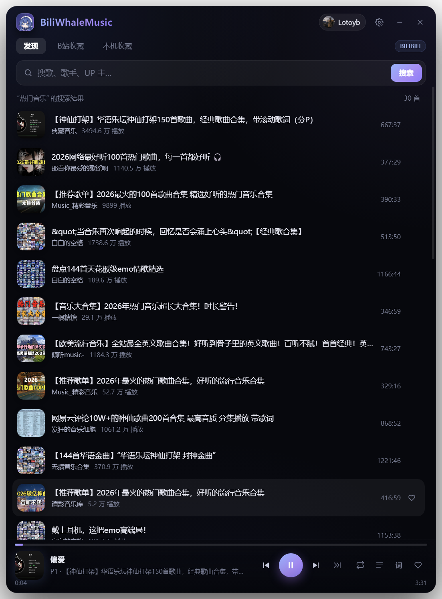
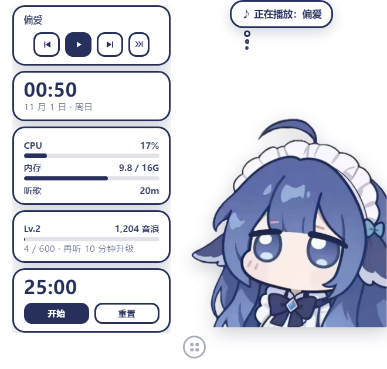
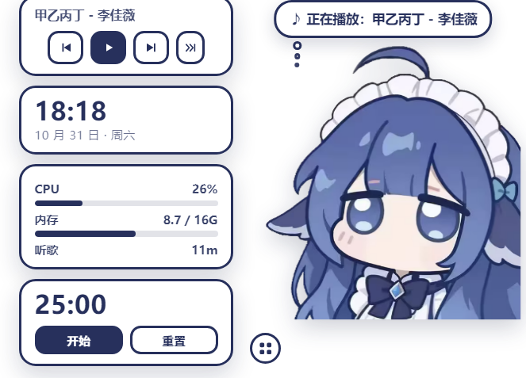

# 鲸音 BiuWhale · 小鲸鱼 × B站音乐播放器


> [English](README.en.md) · 中文

把几个开源项目「合成一个」的可运行实验：

| 来源 | 借来的东西 |
| --- | --- |
| **Biu**（wood3n/biu，Electron + React） | B 站音源：WBI 签名、搜索、视频详情、音频流解析、播放器交互范式 |
| **dsh-whale-widget**（MeteorNOX，DSH Web 插件，MIT） | 桌宠形象与交互：DeepSeek 小鲸鱼娘、白底深蓝描边思考气泡、rua 摸摸动图 |
| **DesktopFriends**（Tosuke-sama/DesktopFriends，Tauri + Vue + Live2D） | 「桌面伙伴」产品形态：透明置顶小窗、播放状态联动、Live2D 插槽 |
| **ANeko**（pass-with-high-score/ANeko，Android + Compose） | 桌面宠物交互习惯：拖动、右键菜单、置顶小窗 |

> 播放器与 B 站接口为独立实现；桌宠形象与气泡风格复刻自 **dsh-whale-widget**（MIT，
> 见 `assets/whale/LICENSE-dsh-whale-widget.txt`）。







## 它能做什么

- **小鲸鱼桌宠**：透明、无边框、始终置顶的小窗，**固定停在右下角，不会自己走动**；
  按住可以拖到任意位置，位置会记住，下次启动还在原处。
- **单击开面板 / 双击摸头**：单击鲸鱼展开或收起组件面板（面板第一张卡就是播放控制）；
  双击是摸头——`rua.gif` + 爱心 + 气泡反馈。
- **桌宠组件面板**：鼠标移到鲸鱼上，左下角会出现一个圆形「田」按钮，点开是贴着鲸鱼的小面板，
  五张卡片自上而下：
  - **播放控制**：当前曲名 + 上一首 / 播放暂停 / 下一首 / 下一个歌单（有合集时才出现）；
  - **时钟**：时间 + 日期星期；
  - **系统**：CPU 与内存占用（实时进度条，超 80% 变红）+ 累计听歌时长；
  - **成长**：等级 / 音浪值 / 距离下一级的进度条（听歌就会涨）；
  - **番茄钟**：25 分钟倒计时，开始/暂停/重置，结束冒气泡提醒。

  面板开合状态会记住，下次启动直接恢复。
- **听歌计时**：边听边累加（暂停不计），每 10 秒落盘一次，退出、刷新、重启都接着累加；
  数据存在 `biuwhale.json` 的 `listenTotal` / `listenToday` / `listenDate`，跨天时当天的数会归零。
  音浪值 = 累计听歌秒数，等级按 `1 + floor(sqrt(音浪 / 600))` 算，约 10 分钟升一级。
- **widget 同款思考气泡**：白底 + 深蓝描边 + 三颗小圆点，切歌时自动显示曲名。
- **听歌时它会摇摆，还会看心情**：燃曲快速大幅摇、抒情曲慢摇、单曲/本地收藏会蹦两下；
  暂停后恢复漂浮。
- **弹幕氛围**：切歌时从这首视频的热门弹幕里挑一条，气泡里「吐槽」给你看（同一视频只取一次，失败就安静）。
- **歌词哼唱**：有歌词时，鲸鱼气泡会像打字机一样逐字「唱」出当前这一句；没歌词就显示曲名。
- **听歌时光机**：如果去年今天你也用过，启动三分钟后会冒泡「去年今日你在听《…》」。
- **摸头彩蛋**：连摸 3 下会转圈，连摸 5 下爱心变星星；23 点以后摸头会被催去睡觉。
- **B 站登录（全局）**：右上角账号胶囊，任何页面都能点——未登录直接拉起 B 站官方登录页
  （扫码/密码/短信，窗口可自由缩放），登录后显示头像和昵称；点开可「打开 B站收藏 / 退出登录」。
- **B 站收藏**：「B站收藏」标签页里可切换收藏夹、直接播放收藏的视频，账号信息只存本机。
- **本机收藏**：点歌曲右侧的心形收藏到本地，不需要登录。
- **B 站音源**：关键词搜索 → 选歌 → 直接播放视频里的音轨（无需打开网页）。
- **多 P 合集自动展开**：遇到「100 首合集」这类多分 P 视频，会自动把每个分 P 拆成队列条目，
  每一条都按「曲名 - 歌手」解析并显示歌名。
- **下一歌单**：播放条上「»|」按钮跳过当前合集，直接播放下一个歌单的第一首。
- **B站收藏刷新**：收藏页右上角「↻ 刷新」手动刷新；切回收藏页且数据超过 60 秒也会自动静默刷新。
- **歌词**：播放条右侧「词」按钮打开歌词面板，按当前播放时间逐行高亮并自动滚动，点某一行可以跳转；
  找不到歌词时面板里直接显示歌名和「暂无歌词」。
- **播放器**：播放/暂停、上一首/下一首、列表循环/单曲循环/随机、进度拖动、播放队列抽屉。
- **深色界面**：近黑底 + 冷蓝/紫点缀，默认窗口 **640×900**（首次居中，之后记住你拖出来的大小和位置），标题栏用新图标。
- **托盘 + 媒体键**：托盘菜单控制播放、显示/隐藏桌宠、退出；媒体键全局可用。
- **关闭行为**：默认点窗口右上角「×」＝直接退出（桌宠一起关掉，不留后台进程）；
  想让它常驻托盘，在设置里打开「关闭窗口后收到托盘」，之后用托盘菜单里的「退出」才真正退出。
- **设置**：桌宠大小、置顶、音量（不再需要手动粘贴 Cookie，登录走右上角账号）。

## 运行

```bash
cd BiuWhale
npm install          # 或 pnpm install
npm start
```

要求：Node.js 18+、Windows 10/11（macOS / Linux 未测试，理论可用）。

> 本目录已经附带一个免安装的 Electron 运行时（`runtime/`），**不想装 Node 也可以直接双击桌面上的
> `鲸音 BiuWhale` 快捷方式**（推荐）启动；它指向 `runtime/nekobiu.exe` 并带上必要参数与图标，
> 因为是 exe 快捷方式，不会触发 Windows 的「无法验证发布者」脚本提示。
> 也可以双击 `start.cmd`：会先弹一个「打开文件 - 安全警告」，点「运行」就行，那是 Windows
> 对未签名 `.cmd` 脚本的常规确认，不是杀毒报警。`start.cmd` 使用 `--no-sandbox`、`--force-device-scale-factor=1`
> 与本地 `userdata/`，适配 150% 缩放的虚拟机 / 远程桌面（否则透明小窗可能被 DPI 放大到屏幕外）。
>
> 在受限环境（无管理员权限 / 沙箱 / 部分虚拟机）里 Chromium 沙箱起不来时，用
> `npm start` 已内置 `--no-sandbox`；想用默认沙箱可执行 `npm run start:default`。
> 如果用户目录不可写，追加 `--user-data-dir=./userdata`。

## 打包（安装包）

推荐直接用项目里的脚本（构建目录固定 `D:\biuwhale-build`，纯英文 + D 盘）：

```powershell
powershell -NoProfile -ExecutionPolicy Bypass -File scripts\build-installer.ps1
# 或者双击 打包.cmd
```

它会自动：复制源码到 `D:\biuwhale-build` → 用 `mklink /J` 复用现有 `node_modules`
→ 调 `electron-builder --win nsis` → 产物拷回 `dist\` → 清理构建目录。
临时文件也会指到 `D:\temp`，不往 C 盘写。

> 安装包未做代码签名，首次运行 Windows 会弹 SmartScreen「已保护你的电脑」，
> 点「更多信息 → 仍要运行」即可；企业分发请自行签名。
>
> ⚠️ **构建目录必须是纯英文路径**：项目路径含中文时 NSIS 会报
> "Error writing temporary file" 或 NSIS Error。手动写法：
>
> ```bat
> mklink /J D:\biuwhale-build\node_modules "D:\Users\lenovo\Desktop\豆包对话\BiuWhale\node_modules"
> cd /d D:\biuwhale-build && node_modules\.bin\electron-builder.cmd --win nsis
> ```
>
> 安装包本身也要放在英文路径下双击执行，否则同样会弹 NSIS Error。
> 打包复用本地已安装的 Electron（`build.electronDist` 配置），首次构建若网络受限
> 请配置镜像源：
>
> ```powershell
> $env:ELECTRON_MIRROR="https://npmmirror.com/mirrors/electron/"
> $env:ELECTRON_BUILDER_BINARIES_MIRROR="https://npmmirror.com/mirrors/electron-builder-binaries/"
> ```

## 目录结构

```
BiuWhale/
├── main.js                 # 主进程：窗口、托盘、快捷键、IPC、B站登录、桌宠定位
├── preload-player.js       # 播放器窗口的 contextBridge API
├── preload-pet.js          # 桌宠窗口的 contextBridge API
├── src/
│   ├── bili.js             # B 站客户端：WBI 签名、搜索、详情、音频流、收藏夹
│   └── store.js            # 本地配置/收藏持久化（JSON）
├── renderer/
│   ├── player/             # 播放器界面（发现 / B站收藏 / 本机收藏）
│   └── pet/                # 桌宠：DeepSeek 小鲸鱼（HTML/CSS）
├── assets/
│   ├── icon.ico / icon.png # 应用图标（鲸鱼娘插画 + 深蓝紫渐变圆角底，多尺寸）
│   ├── tray.png            # 托盘图标（32px）
│   └── whale/              # 鲸鱼娘素材（dsh-whale-widget，MIT）
├── docs/images/            # README 用截图
└── shots/                  # 开发态 --shot 截图（打包后写到 userData\shots）
```

> `--shot` 是自检模式：启动后自动截图播放器/桌宠到 `shots/` 并退出。
> 打包版没有可写的项目目录，日志与截图统一写到 `userData`（Windows 下是
> `%APPDATA%\BiuWhale`，或你用 `--user-data-dir` 指定的目录）。

## 实现要点

### 1. 桌宠窗口

- `BrowserWindow({ transparent, frame: false, alwaysOnTop: 'screen-saver', skipTaskbar: true })`
- 窗口 **440×316**：右侧 240px 是鲸鱼（上方气泡），左侧 200px 是组件面板区；
  面板收起时这块区域完全透明、点击穿透，不影响桌面操作。
- 默认 `setIgnoreMouseEvents(true, { forward: true })`，鼠标移到鲸鱼、组件面板或「田」按钮上
  才恢复交互，这样桌宠不会挡住桌面点击，按钮也点得到。
- **固定站位**：默认停在主屏右下角（24px 边距），没有自动行走逻辑；`petPos` 记住拖动后的坐标。
- 单击 / 双击用 260ms 计时器区分：第一下先等一等，第二下到来就是「摸头」，否则展开/收起组件面板。
- 拖动采用指针捕获 + 主进程跟随光标，松手后夹回屏幕范围并落盘。

### 2. 桌宠组件（widgets）

- 布局：`#petCol` 固定右侧 240px（`--s` 变量跟随桌宠缩放），`#panel` 在它左边、宽 180px，
  卡片风格与思考气泡一致（白底 + 2.5px 深蓝描边 + 圆角）。
- 三个内置组件：
  - **时钟**：`setInterval(1000)` 更新 `HH:MM` 与「M 月 D 日 · 周X」。
  - **系统**：主进程每 2 秒用 `os.cpus()` 的 times 差值算 CPU 占用、`os.freemem()/os.totalmem()`
    算内存，通过 `pet:stats` 推给渲染进程（面板关闭时不采样，省电）。
  - **番茄钟**：渲染进程内 25 分钟倒计时，按钮在「开始 / 暂停」间切换，归零时冒气泡。
  - **播放控制**：曲名来自 `playback` 事件，三个按钮走 `pet:command`（prev / toggle / next）。
- 开关：`#widgetBtn`（鲸鱼左缘的半圆按钮）切换 `#panel.hide`，同时通过 `pet:panel` IPC
  把状态写进 `biuwhale.json` 的 `petPanelOpen`，启动时由主进程回推。
- 加新组件：在 `renderer/pet/index.html` 里加一张 `.card`，在 `pet.js` 里加对应渲染函数即可；
  需要主进程数据时再加一路 `pet:*` IPC。

### 3. B 站登录与收藏

- 登录入口是标题栏的**账号胶囊**（全局，任何标签页可见）：未登录显示「登录」，点击直接拉起登录窗；
  已登录显示头像+昵称，点开是「打开 B站收藏 / 退出登录」。
- 登录窗口直接加载 `https://passport.bilibili.com/login`，用 B 站自己的扫码/密码/短信流程；
  默认 660×840、**可自由缩放**，并按 `scrollWidth/clientWidth` 自动调 `zoomFactor`：
  拉窄时缩小页面、拉宽后恢复，保证二维码始终完整。
- 轮询 `session.cookies`，拿到 `SESSDATA` 后立刻用 `nav` 接口验证，成功后把
  `SESSDATA / bili_jct / DedeUserID / buvid3 …` 拼成 Cookie 串存进本地，并记录 `mid`。
- 收藏夹接口：`/x/v3/fav/folder/created/list-all`、`/x/v3/fav/resource/list`（匿名不可用，需登录）。
- 退出登录会同时清掉本地 Cookie 与 Electron 会话 Cookie。

### 4. 播放状态联动

播放器通过 `playback:update` 把 `{playing,title,artist}` 同步给主进程，主进程再转发给桌宠：
面板里的播放/暂停图标与鲸鱼的摇摆状态都跟着它走。

### 5. B 站接口

- `buvid3/buvid4`：`/x/frontend/finger/spi`
- WBI key：`/x/web-interface/nav` → `wbi_img.img_url/sub_url` → 混淆表取 32 位 mixinKey
- 搜索：`/x/web-interface/wbi/search/type`（`w_rid` + `wts`）
- 播放地址：`/x/player/wbi/playurl`（`fnval=16` 取 DASH 音频，按 30280 > 30232 > 30216 选码率）
- 音频 CDN 需要 `Referer: https://www.bilibili.com/`，主进程用
  `session.webRequest.onBeforeSendHeaders` 统一补上（含封面图 `*.hdslb.com`）。

## 已知限制

- 收藏夹目前只读：可以浏览、播放，暂不支持在 App 内增删收藏。
- 未做下载、关注动态；歌词来自网易云音乐公开接口（按歌名/歌手/时长匹配），匹配不到时只显示歌名。
- 桌宠组件目前是内置的 4 张卡（播放 / 时钟 / 系统 / 番茄钟），还没有第三方插件机制。
- 多 P 合集点开后会按 P 展开成队列，播放条主行显示**曲名**、副行显示「P几 · 合集名」，下一首按 P 顺序走。
- 接口来自 B 站 Web 端公开接口，随时可能变更；仅供个人学习，请勿商用。
- 在 150% 缩放的虚拟机 / 远程桌面里，透明置顶小窗的定位可能偏移（Windows DPI 虚拟化），
  用 `start.cmd` 里的 `--force-device-scale-factor=1` 可规避。

## 文档

- `docs/三个项目合并方案.md`：三个开源项目能不能合并的调研与结论
- `docs/功能实现-AI提示词.md`：六个桌面宠物功能的实现提示词
- `docs/六个功能实现说明.md`：这六个功能最终怎么实现的、参考了哪些开源项目

## 许可与致谢

本仓库代码为 MIT。第三方素材/思路：

- **dsh-whale-widget**（`MeteorNOX/DeepSeek-Balance-Whale-Widget`）：MIT，
  Copyright (c) 2026 MeteorNOX。本项目使用其 `DSniang1.png`（小鲸鱼娘）、`DSniang02.png`
  与 `rua.gif`，并复刻其气泡视觉；许可证随素材放在 `assets/whale/`。
- **Biu**：PolyForm Noncommercial 1.0.0 —— 仅限非商业使用；商用需联系原作者授权。
- **ANeko**：LGPL-2.1 —— 若移植其代码，需要以 LGPL 兼容方式开源相应修改（本项目只借鉴行为）。
- **DesktopFriends**：`package.json` 声明 MIT 但仓库无 LICENSE 文件；Live2D Cubism Core
  与示例模型另有许可，本项目未使用其代码与模型。

详见 [docs/三个项目合并方案.md](docs/三个项目合并方案.md)。
